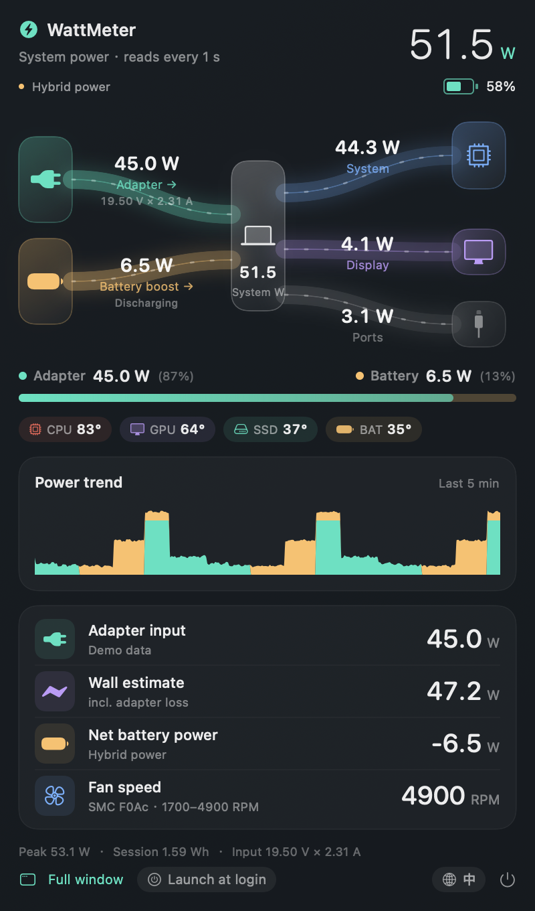

# WattMeter

**English** · [简体中文](README.zh-CN.md)

A native macOS menu-bar power monitor. It shows real-time system power, how much of it comes from the power adapter versus the battery, plus fan speed — as a power-flow diagram and as time-series charts.

- Runs on **Apple Silicon (M-series) and Intel Macs**, macOS 13 or later
- Swift + SwiftUI + Swift Charts, no third-party dependencies
- **No root, no kernel extension, no network access** — read-only IOKit/SMC access
- Optional **launch at login** (`SMAppService.mainApp`, no helper process)
- **Bilingual UI** (English / 简体中文) — switch from the panel footer or the right-click menu
- Builds with the macOS Command Line Tools alone (Xcode not required)

| Menu bar panel (charging) | Panel (battery) | Main window |
| --- | --- | --- |
|  |  |  |

---

## 1. What it shows

| Requirement | Implementation |
| --- | --- |
| Total power | Menu bar shows live system power; the panel shows a large readout from AppleSMC `PSTR` |
| Where the power comes from | A Sankey-style flow diagram: adapter and battery ports on the left, the system in the middle, loads on the right, plus an adapter-vs-battery share bar. The battery node is **always** present when a battery is installed |
| Visualisation | Flow diagram; stacked area chart (adapter vs battery, 1 / 5 / 15 min); line chart of total power and net battery power in the main window |

Also included: adapter DC input (with measured input voltage and current) and rated wattage, estimated wall power, battery percentage and time remaining, fan RPM, CPU / GPU / SSD / battery / platform temperatures, display backlight power, USB-C output power, and session energy (Wh).

---

### Hybrid power (weak charger + high load)

When the adapter cannot cover the load — a 45 W charger on a 16-inch MacBook at full tilt, for
example — macOS draws the difference from the battery. The diagram then shows **two sources on the
left**: the adapter on top, the battery below, and two ribbons converging into the machine. The
status pill reads “Hybrid power”, the source bar splits adapter/battery, and the battery port on the
left shows “discharging” instead of charging.



The split is a pure function (`PowerReader.split`) that is covered by `wattprobe --split-test`:

```
adapter → load = min(input, load)
battery → load = max(0, load - input)
charging       = max(0, input - load)
```

A 0.7 W dead band prevents sampling skew from being shown as battery supply.

## 2. Data sources

| Source | API / keys | Typical refresh | Notes |
| --- | --- | --- | --- |
| Total system power | AppleSMC `PSTR` | sub-second | whole-system rail |
| Adapter DC input | AppleSMC `PDTR`, `PD0R` | sub-second | `PD0R` exists on desktop Macs; the flow diagram shows measured V × A on the input node |
| Input voltage / current | AppleSMC `VD0R` / `ID0R` | sub-second | measured rails; `PDTR` equals `VD0R × ID0R` |
| Battery power | `AppleSmartBattery` voltage × amperage | ~1 s | sign normalised by charge state |
| Battery state / % / time left | IOKit `IOPowerSources` | event-driven | |
| Adapter rating & name | `AdapterDetails` | on plug/unplug | |
| Fallback telemetry | `PowerTelemetryData` | **≈20 s** | `SystemLoad` / `SystemPowerIn`, adapter loss |
| Chip power (CPU / GPU / ANE / DRAM) | IOReport `Energy Model` (merged with `GPU Stats` / `CPU Stats` / `AMC Stats`) | ~1 s | private IOReport via `dlopen`; energy deltas converted with the channel unit label. On macOS 27 the Energy Model CPU counters are gated, so CPU falls back to PMP per-cluster histograms; DRAM falls back to SMC `PZD*` |
| Fan | AppleSMC `F?Ac` / `F?Mn` / `F?Mx` / `F?Tg` | sub-second | keys are discovered at launch (names and `flt` / `fpe2` / `ui16` types differ per model); multiple fans report the maximum RPM. On M3/M4 MacBooks the thermal manager stops the fans entirely when idle, so `0 RPM · stopped` is normal |
| Display backlight | AppleSMC `PDBR` / `PBwo` / `PBLR` | sub-second | only on Macs with an internal display |
| USB-C output | AppleSMC `D1..D4 JV×JI`, else `PowerOutDetails` | sub-second | charging input channel is excluded |
| Component temperatures | AppleSMC `Tp*` (CPU), `Tg*` (GPU), `TH0*` (SSD), `TB0*` (battery), `Ts0P` (platform) | sub-second | the app enumerates SMC keys at launch, because suffixes differ per model (e.g. M2 exposes `Tg0e/f/m/n/q/r` instead of `Tg0D`); unavailable components show “—” |

Two practical rules:

1. **Real-time values must come from SMC.** `PowerTelemetryData` only refreshes about every 20 seconds, so it is used as a fallback (and for the adapter-loss estimate), never for the live readout.
2. **Battery values come from IOPS/IORegistry.** SMC battery keys differ between models, so battery power is derived from voltage × amperage and the direction is normalised by the charging state.

> References: `PSTR` is AppleSMC's “System Total Rail” ([chromium `smc_internal_types_mac.h`](https://chromium.googlesource.com/chromium/src/+/d3c3c840981b951410572e950c8497befdabff05/components/power_metrics/smc_internal_types_mac.h)); `PDTR` is adapter DC input and `PowerTelemetryData` refreshes slowly ([mactop fallback notes](https://github.com/vladkens/macmon/blob/850812f405c2e4180d03a31cf3f77674f9d9520e/docs/plans/20261111-mactop-fallbacks.md)); `Energy Model` in IOReport is unreliable on macOS 27, so it is not used.

---

## 3. Power model

Let:

- `load` = AppleSMC `PSTR` (total system power, W)
- `input` = AppleSMC `PDTR` / `PD0R` (adapter DC input, W)
- `loss` = `PowerTelemetryData.AdapterEfficiencyLoss` (W)

Split across the load:

```
adapter → load   = min(input, load)
battery → load   = max(0, load - input)      // weak charger + high load
charging power   = max(0, input - load)
wall estimate    ≈ input + loss             // fallback: input / 0.9
```

Net battery power (positive = charging, negative = discharging):

```
P_battery = Voltage(mV) × Amperage(mA) / 1e6
direction is normalised with IsCharging / ExternalConnected
system component = total − display − ports
```

Two engineering details:

1. **Sampling skew.** `PSTR` lags one SMC sweep behind `PDTR`; subtracting them directly produces phantom ±0.7 W “battery power”. Desktop Macs are forced to 100% adapter, and laptops use a 0.7 W dead band.
2. **Graceful fallback.** If the SMC keys are missing, the reader falls back to `PowerTelemetryData` and labels the source in the UI.

---

## 4. Architecture

```
AppleSMC (PSTR/PDTR/PD0R, F0Ac, PDBR, D1..D4) ─┐
AppleSmartBattery (V/I, AdapterDetails,         ├─> CSystemPower (C, IOKit, no root)
  PowerTelemetryData)                           │        │
IOPS (state, percent, time left) ───────────────┘        ▼
                                              WattMeterCore (Swift)
                                              ├─ PowerReader   raw → watts + split
                                              ├─ PowerSampler  1 Hz background sampling
                                              ├─ HistoryBuffer 1 h ring buffer, Wh integration
                                              └─ PowerStore    @Published state (main thread)
                                                        │
                                    WattMeterUI (SwiftUI + Swift Charts)
                                                        │
                     AppKit menu bar: NSStatusItem("12.3W") + NSPopover + main window
```

```
wattmeter/
├── Package.swift                 # SwiftPM manifest (for Xcode users)
├── Makefile
├── scripts/
│   ├── build.sh                  # clang + swiftc build (no Xcode needed)
│   ├── make-icon.sh              # generate Resources/WattMeter.icns
│   └── package-dmg.sh            # build a drag-to-Applications DMG
├── Resources/Info.plist          # LSUIElement = true (no Dock icon)
├── Sources/
│   ├── CSystemPower/             # SMC user client + IORegistry + IOPS
│   ├── WattMeterCore/            # models, power model, sampler, history
│   ├── WattMeterUI/              # dark panel, flow diagram, charts, main window
│   ├── WattMeter/                # AppKit menu-bar app
│   ├── wattprobe/                # CLI probe for checking data sources
│   └── wattmeter-snapshot/       # off-screen renderer for screenshots
└── docs/preview-*.png
```

- Sampling runs on a background queue (`DispatchSourceTimer`, 1 Hz, 120 ms leeway); a sample costs well under a millisecond
- No shell calls and no `powermetrics` (which requires root)

---

## 5. UI design

The visual language is inspired by [PowerLens](https://github.com/kinghhhin-design/power), a similar open-source menu-bar power monitor; the time-series charts are our addition.

| Element | Detail |
| --- | --- |
| Panel | 400 × 680 pt dark frosted glass (`NSVisualEffectView` with `.popover` material, behind-window, darkAqua) |
| Accents | mint `#6EE0C2` (power), amber `#F5C273` (battery), blue `#7DB0FA` (system), purple `#BA9CF5` (adapter/ports) |
| Type | SF Rounded; 31 pt light primary readout, 19 pt medium row values, 9–10 pt captions |
| Flow diagram | 364 × 180: on the left, the adapter port on top and the battery port below (the battery is always drawn when one is installed); the Mac in the middle; loads on the right — system (split further into CPU / GPU / ANE when those readings exist) plus display / ports. Chip branches with no data are **hidden**; if none of CPU/GPU/ANE is available the diagram falls back to the plain system/display/ports layout. Rounded bezier links with gradient, glow and dots showing the direction of power. While charging, the battery link runs **right-to-left** (power flowing into the battery); while discharging or in hybrid mode it runs left-to-right. Link width is fixed at 14 pt so the diagram does not jitter when readings change |
| Temperatures | CPU / GPU / SSD / battery chips in the panel; a full temperature card in the main window. Values turn amber above 65 °C and red above 80 °C |
| Charts | Stacked area of adapter vs battery, plus a total/net-battery line chart in the main window |
| Main window | 1020 × 832 pt (scrollable if the user shrinks it): flow diagram, stacked area chart, line chart, and adapter / battery / temperature cards |
| Language | English / 简体中文, switch in the panel footer or via the right-click menu (persisted) |
| About | An About window (ⓘ button or right-click menu) with version/build, requirements, links, credits and a “copy diagnostics” button |
| Launch at login | Toggle in the panel footer or the right-click menu. Uses `SMAppService.mainApp`; macOS may ask for approval in System Settings → General → Login Items |
| Menu bar | Monospaced digits, width auto-fitted, detailed tooltip, single-instance guard |

Charging, discharging, battery standby and no-battery desktops each get a different diagram layout;
branches without telemetry are dimmed instead of being hidden. Whenever a battery is installed it is
always present on the diagram (right side while charging, left side while supplying), and the
battery-only mode is animated like every other mode.

---

## 6. Build & run

Requirements: **macOS 13 or later**, Command Line Tools (`xcode-select --install`). Xcode is not
required. The app is built as a universal binary (arm64 + x86_64) with a macOS 13.0 deployment target.

### Supported hardware

| Hardware | Status |
| --- | --- |
| **Apple Silicon Macs (M1 / M2 / M3 / M4 / M5 family)** | Recommended; SMC power rails, fan, temperatures, battery and USB-C ports are read directly |
| Intel Macs | Supported; falls back to `PowerTelemetryData` / IOPS when SMC keys are missing |
| Mac desktops (Mac mini / Studio / Pro) | Supported; no battery or internal display, those rows show “—” |
| macOS 13 / 14 / 15 and later | Supported by the same universal binary |

```bash
git clone https://github.com/albertz-source/WattMeter.git
cd WattMeter

./scripts/build.sh                 # or: ./scripts/build.sh debug
open dist/WattMeter.app            # menu-bar app, no Dock icon

./scripts/package-dmg.sh           # build a drag-to-Applications DMG
./.build/bin/wattprobe             # CLI probe, 10 samples at 1 s
./.build/bin/wattprobe --keys      # list candidate SMC keys for your model
./.build/bin/wattprobe --split-test   # self-check the adapter/battery/charge split
.build/bin/wattmeter-snapshot --view dashboard --state charging --out docs/preview-panel.png
./.build/bin/wattmeter-snapshot --view dashboard --state hybrid  --out docs/preview-panel-hybrid.png
```

Self-checks:

```bash
dist/WattMeter.app/Contents/MacOS/WattMeter --selftest   # sample for 3.5 s and print
dist/WattMeter.app/Contents/MacOS/WattMeter --diag       # verify the status item exists
dist/WattMeter.app/Contents/MacOS/WattMeter --login-item status   # launch-at-login state
dist/WattMeter.app/Contents/MacOS/WattMeter --login-item enable   # register (disable to undo)
```

The DMG (created by `scripts/package-dmg.sh`) contains `WattMeter.app`, an `Applications` shortcut and a short install note: open it, drag the app to Applications, eject.

> Why not SwiftPM: `swift build` needs writable user-level caches and sandbox permission for manifest compilation, which fails in restricted environments. `scripts/build.sh` calls `clang`/`swiftc` directly and keeps all caches inside the project. On a normal machine with Xcode, `swift build` works too.

### Publishing a release

```bash
# 1. bump the version in Resources/Info.plist (CFBundleShortVersionString / CFBundleVersion)
./scripts/build.sh release
./scripts/package-dmg.sh          # → dist/WattMeter-<version>.dmg
git tag v<version>
git push origin v<version>
```

Then on GitHub: **Releases → Draft a new release → choose the tag → attach
`dist/WattMeter-<version>.dmg` → publish**. Users download the DMG, open it and
drag `WattMeter.app` into Applications.

### Distribution

- The bundled build is **ad-hoc signed**; on another Mac, right-click → Open, or `xattr -dr com.apple.quarantine /Applications/WattMeter.app`
- For public distribution, sign with a Developer ID and notarise:
  ```bash
  codesign --deep --force --options runtime --sign "Developer ID Application: ..." dist/WattMeter.app
  xcrun notarytool submit dist/WattMeter-<version>.dmg --keychain-profile "AC_PASSWORD" --wait
  xcrun stapler staple dist/WattMeter-<version>.dmg
  ```
- App Sandbox is not supported (SMC user-client and IORegistry access are blocked in a sandbox), so this app is not suitable for the Mac App Store

---

## 7. Verify on your own Mac (including laptops)

```bash
./.build/bin/wattprobe --keys      # which SMC power/fan/backlight keys your model exposes
./.build/bin/wattprobe 20 1        # 20 samples, one per second
./.build/bin/wattprobe --split-test   # adapter/battery/charge split rules
.build/bin/wattprobe --battery      # full battery-machine diagnostic
./.build/bin/wattprobe --fans         # list every fan SMC key with its decoded value
./.build/bin/wattprobe --chips        # dump IOReport energy channels (CPU/GPU/ANE/DRAM)

# The installed app binary can run the same diagnostics (no developer tools needed)
/Applications/WattMeter.app/Contents/MacOS/WattMeter --fans
/Applications/WattMeter.app/Contents/MacOS/WattMeter --battery
```

On a MacBook, `--battery` should normally show:

- `电池安装: 是`, battery voltage around 11–13 V, and a **negative** battery current while discharging
- `分流` numbers that add up: `电源→负载 + 电池→负载 ≈ 整机`
- the correct state: `纯电池供电` / `充电中` / `混合供电` / `外接电源`

Four scenarios worth testing by hand:

| Scenario | Expected UI |
| --- | --- |
| Charger unplugged | single battery source on the left, adapter input `—` (a stale `PDTR` value is ignored) |
| Plugged in and charging | adapter on the left, charging branch on the right, state “Charging” |
| Weak charger + high load | two sources on the left (adapter + battery), state “Hybrid power” |
| Full and idle on AC | adapter only, state “Fully charged” |

Known model differences handled in code: `Amperage` may be stored as an unsigned 32-bit
two's-complement value, the charging port also shows up in the `D1..D4` rails (filtered by matching
the adapter input power), and battery temperature keys differ per model.

If `PSTR` / `PDTR` are missing on your model, the app falls back to `PowerTelemetryData` (marked “System telemetry” in the UI). On fanless Macs the fan row shows “—”.

---

## 8. Limitations

1. **Wall power is an estimate.** `PDTR` is DC input after AC/DC conversion; the app adds the system-reported adapter loss. Expect a 5–15% difference from a wall meter.
2. **Laptop battery sign convention** is normalised from the charging state; it is worth a quick cross-check with macOS's own battery information on a MacBook.
3. On Intel Macs `PSTR`/`PDTR` usually exist; if not, the app falls back to IOPS voltage/current plus telemetry.
4. No persistence, CSV export, notifications or login item yet.
5. Builds are ad-hoc signed, not notarised.
6. Sub-system power comes from the private IOReport framework. macOS 27 gates the Energy Model
   CPU/DRAM counters (they stay at 0 unless an entitled sampler runs), so on macOS 27 those values
   may show “—”; macOS 26 and older work normally. GPU counters keep working.
7. Temperature keys differ between models. The app discovers `Tp*` / `Tg*` / `TH0*` keys by enumerating SMC at launch, but some Macs simply do not expose a GPU or battery sensor (desktop Macs have no battery); those rows then show “—”.

---

## 9. Roadmap

- [ ] IOReport / PMP sub-system breakdown (CPU / GPU / ANE / DRAM), with SMC fallback on macOS 27
- [ ] Verify and calibrate on more MacBook models
- [ ] CSV / JSON export, history persistence, daily energy cost
- [ ] Login item (`SMAppService`), threshold notifications, low-battery alert
- [ ] Developer ID signing, notarisation and a DMG release workflow

---

## 10. References

- [PowerLens — visual language reference](https://github.com/kinghhhin-design/power)
- [mactop fallback notes (PSTR/PDTR/PD0R semantics, Energy Model on macOS 27)](https://github.com/vladkens/macmon/blob/850812f405c2e4180d03a31cf3f77674f9d9520e/docs/plans/20261111-mactop-fallbacks.md)
- [chromium `smc_internal_types_mac.h` (TotalPower = PSTR)](https://chromium.googlesource.com/chromium/src/+/d3c3c840981b951410572e950c8497befdabff05/components/power_metrics/smc_internal_types_mac.h)
- [wattop — PDTR input power and slow telemetry in practice](https://crates.io/crates/wattop)
- Apple IOKit `IOPowerSources.h` / `IOPSKeys.h`, `AppleSmartBattery` IORegistry node
