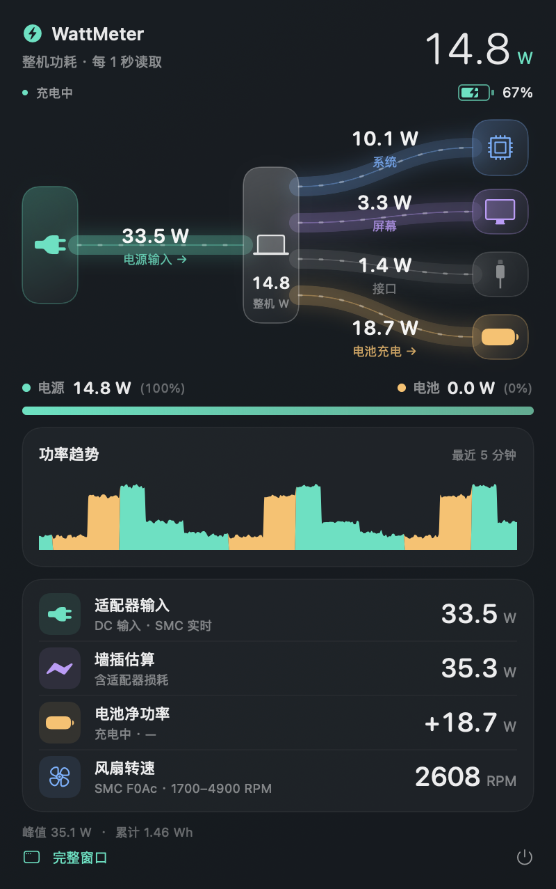
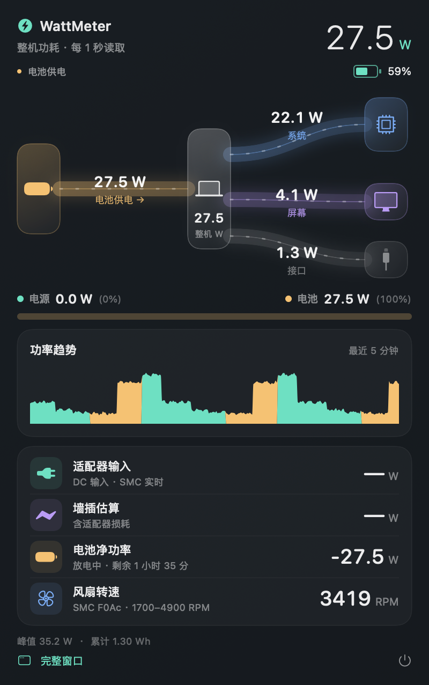
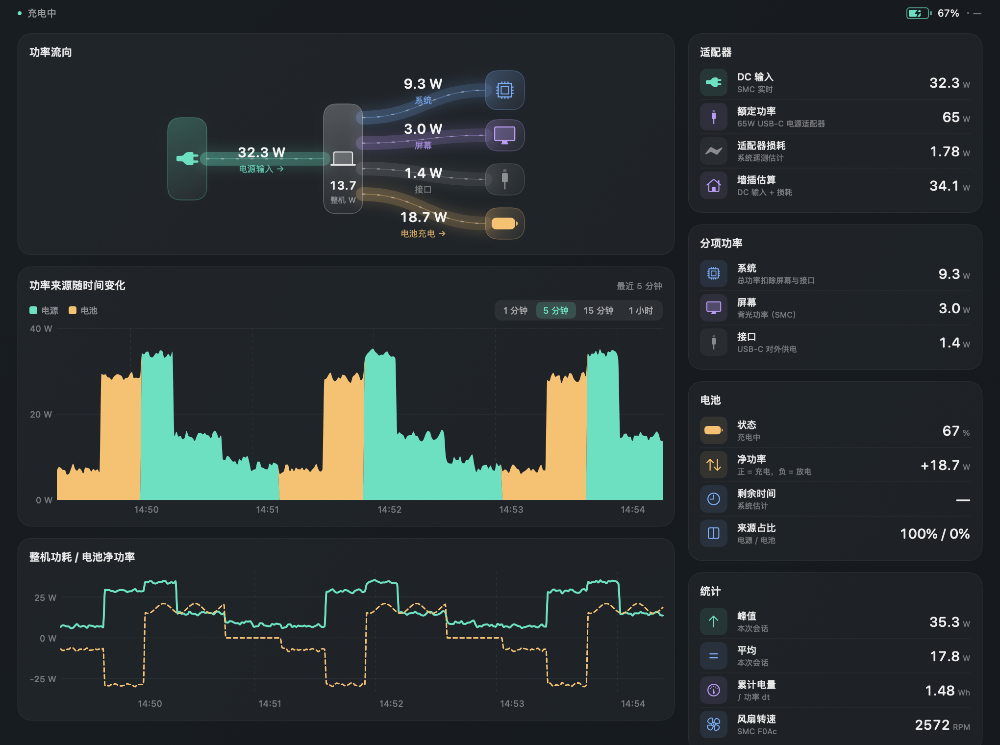

# WattMeter — macOS 实时功率监视器

一个常驻菜单栏的小工具：**显示整机功率 / 适配器输入 / 电池充放电功率，把「功率来自电源还是电池」画成流向图和随时间变化的曲线。**

- 原生 Swift + SwiftUI + Swift Charts，无第三方依赖
- **免 root**、免驱动、免内核扩展
- 只用 macOS 自带的 Command Line Tools 即可构建（本机没有 Xcode）

> 本机（Mac mini M2 / macOS 27.2.1）实测：整机功率空载 12.9 W、压满 4 核升到 21.4 W，约 0.4–1 秒刷新一次。

| 菜单栏面板（充电中） | 面板（电池放电） | 主窗口 |
| --- | --- | --- |
|  |  |  |

（图片由 `wattmeter-snapshot` 离屏渲染，演示数据 + 固定状态 fixture，不需要屏幕录制权限。）

---

## 1. 三个需求怎么落地

| 需求 | 实现 |
| --- | --- |
| ① 显示电源的功率 | 菜单栏实时显示整机功率；面板大号数字 = 整机功耗（SMC `PSTR`），另列适配器 DC 输入（`PDTR`）与墙插估算 |
| ② 显示功率来自电池 / 电源的数量 | **功率流向图**（左=电源/电池，中=整机，右=充电电池，流带宽度∝功率）+ 来源占比条（电源 X W x% / 电池 Y W y%） |
| ③ 用图形画出来 | 流向图 + 堆叠面积图（电源段/电池段，1/5/15 分钟窗口）+ 整机功率/电池净功率折线图（主窗口） |

---

## 2. 数据源（实测结论）

macOS 上「整机功率」有三类来源，差别很大：

| 数据源 | 位置 | 刷新频率（实测） | 免 root | 本机结果 |
| --- | --- | --- | --- | --- |
| **AppleSMC `PSTR`** | SMC 用户客户端 | **约 0.4–1 秒** | ✅ | 整机 12.9 → 21.4 W，能跟随 CPU 负载 |
| **AppleSMC `PDTR`** | 同上 | 同上 | ✅ | 适配器 DC 输入；台式机上与 `PSTR` 基本相等 |
| **`PowerTelemetryData`** | IORegistry `AppleSmartBattery` | **约 20 秒**才变一次 | ✅ | 同一时刻恒定 12.678 W，压测也不动 → 只能兜底 |
| **IOPS / `AppleSmartBattery`** | IOKit PS + IORegistry | 事件驱动 / 1–2 秒 | ✅ | 电池电量、充放电状态、剩余时间、`Voltage × Amperage` |
| `AdapterDetails` | IORegistry | 插拔时 | ✅ | 适配器额定功率（如 65 W）、名称 |
| 屏幕背光 `PDBR`/`PBwo`/`PBLR` | SMC | 约 1 秒 | ✅ | 笔记本内置屏背光功率（本机无内置屏，读不到） |
| USB-C 对外供电 `D1..D4 JV×JI` | SMC | 约 1 秒 | ✅ | 接口对外供电；无设备时为 0（本机键存在、读数为 0） |
| 风扇转速 `F0Ac` / `F0Mn` / `F0Mx` | SMC | 约 1 秒 | ✅ | 本机实测 1701 RPM（范围 1700–4500），支持 `flt` / `fpe2` 两种类型 |
| IOReport `Energy Model` | 私有 `libIOReport.dylib` | 1 秒 | ✅ | CPU/GPU/ANE/DRAM 能耗，但 **macOS 27 上会冻结后补涨**，本项目 v1 不用 |

结论：

1. **实时数字必须走 SMC**（`PSTR` = 系统总功率，`PDTR` = DC 输入）。`PowerTelemetryData` 的 20 秒刷新率画不出曲线。
2. **电池相关**走 IOPS + IORegistry（电量、状态、电压电流）；SMC 的电池功率键在不同机型上命名不统一。
3. **台式机没有电池**时（本机是 Mac mini），自动退化为「100% 来自电源」，界面不显示假的电池数据。
4. 子系统拆分（CPU / GPU / ANE / DRAM）需要 IOReport，属于 v2；没有它，需求 ①②③ 也已满足。

> 参考：`PSTR` 是 AppleSMC 的 “System Total Rail”（见 [chromium smc_internal_types_mac.h](https://chromium.googlesource.com/chromium/src/+/d3c3c840981b951410572e950c8497befdabff05/components/power_metrics/smc_internal_types_mac.h)）；`PDTR` 是适配器 DC 输入、`PowerTelemetryData` 约 20 秒刷新、`PD0R` 是台式机 DC 输入（见 [mactop 的 fallback 记录](https://github.com/vladkens/macmon/blob/850812f405c2e4180d03a31cf3f77674f9d9520e/docs/plans/20261111-mactop-fallbacks.md)）。

---

## 3. 数据采集架构

```
AppleSMC (PSTR/PDTR/PD0R) ─┐
AppleSmartBattery (V/I,     ├─> CSystemPower (C, 免 root IOKit) ─> WattMeterCore (Swift)
  AdapterDetails, Telemetry)│                                        ├─ PowerReader：原始值 → 功率 + 分流
IOPS (电量/状态/剩余时间) ──┘                                        ├─ PowerSampler：后台 1 Hz 采样
                                                                    ├─ HistoryBuffer：1 小时环形缓冲 + Wh 积分
                                                                    └─ PowerStore：@Published 状态（主线程）
                                                                              │
                                                          ┌───────────────────┴───────────────────┐
                                                          │  WattMeterUI (SwiftUI + Swift Charts) │
                                                          └───────────────────┬───────────────────┘
                                                                              │
                                     AppKit 菜单栏：NSStatusItem("16.8W") + NSPopover(面板) + 主窗口
```

- 采样在后台队列（`DispatchSourceTimer`，1 Hz，leeway 120 ms），读数回主线程更新 UI
- 每次采样约 0.1–1 ms，对续航/性能影响可忽略
- C 层直接用 IOKit/IOPS/CoreFoundation，没有 shell 调用、没有 `powermetrics`（它需要 root）

### 目录结构

```
wattmeter/
├── Package.swift                     # SwiftPM 清单（有 Xcode 的环境可用）
├── Makefile
├── scripts/
│   ├── build.sh                      # 纯 clang + swiftc 构建（无需 Xcode）
│   └── build-app.sh                  # 用 SwiftPM 产物组装 .app（可选路径）
├── Resources/Info.plist              # LSUIElement=true（无 Dock 图标）
├── Sources/
│   ├── CSystemPower/                 # C 桥接：SMC 用户客户端 + IORegistry + IOPS
│   ├── WattMeterCore/                # 模型、派生公式、采样器、历史、演示数据
│   ├── WattMeterUI/                  # 深色面板 / 流向图 / Charts / 主窗口
│   ├── WattMeter/                    # AppKit 菜单栏 App 入口 + 状态项
│   ├── wattprobe/                    # 命令行探针（真机验证数据源）
│   └── wattmeter-snapshot/           # 离屏渲染预览图 + 状态 fixture
└── docs/preview-*.png
```

---

## 4. 功率换算与分流公式

设：

- `load` = SMC `PSTR`（整机功耗，W）
- `input` = SMC `PDTR` / `PD0R`（适配器 DC 输入，W）
- `loss` = `PowerTelemetryData.AdapterEfficiencyLoss`（适配器/充电电路损耗，W）

供给负载的拆分：

```
电源 → 负载 = min(input, load)
电池 → 负载 = max(0, load - input)     // 弱充电器 + 高负载时电池补足
充电功率     = max(0, input - load)     // 接着电源且电池在充
墙插功率估算 = input + loss            // 没有 loss 时按 input / 0.9 估算
```

电池净功率（正 = 充电，负 = 放电）：

```
P_battery = Voltage(mV) × Amperage(mA) / 1e6
方向由 IOPS 的 Is Charging / External Connected 归一化，避免不同机型电流符号不一致
```

两个必要的工程细节：

1. **采样相位差**：`PSTR` 比 `PDTR` 慢一个采样周期，直接相减会凭空出现 ±0.7 W 的“电池供电/充电”。代码对无电池机型强制 100% 电源，对有电池机型加 0.7 W 死区。
2. **遥测兜底**：SMC 键在部分机型/系统上可能缺失，此时退回 `PowerTelemetryData.SystemLoad / SystemPowerIn`，并在界面上标注数据源（`SMC 实时` / `系统遥测`）。

单位统一为 **W**；累计电量 = ∫总功率 dt（Wh，会话内）。

---

## 5. 界面设计

视觉语言参考了同类开源项目 **PowerLens**（[kinghhhin-design/power](https://github.com/kinghhhin-design/power)），并加上了我们自己的时间序列图表。

**菜单栏**：等宽数字，按文字宽度自适应（`16.8W`），tooltip 带电源/电池明细；左键弹面板，右键菜单（主窗口 / 演示 / 退出）；单实例保护。

**弹出面板（400 × 644 pt，深色毛玻璃，以流向图为主体）**：

1. 顶部：应用名 + 大号整机功率（31pt light 圆体 + mint 的 “W”）+ 状态行（状态点、电池图形、电量）
2. **功率流向图**（364 × 180，占面板高度约 30%）：左 = 电源适配器 / 电池，中 = 整机，右 = **四条分支配电**（系统 / 屏幕 / 接口 / 电池）；充电 / 放电 / 待机 / 无电池四种形态自动切换。连线是**圆角贝塞尔流线**：渐变描边 + 柔和辉光 + **由电源向负载方向流动的光点**（dashPhase 取负值，否则会反向），宽度随功率变化，端点精确贴合节点边缘
3. 来源占比条：mint 电源 + amber 电池
4. **紧凑趋势条**：最近 5 分钟的电源 / 电池堆叠面积（无坐标轴，面板里只保留趋势）
5. 明细行：适配器输入、墙插估算、电池净功率、**风扇转速（RPM）**（色块图标 + 右对齐读数）
6. 底部：峰值 / 累计电量、完整窗口、演示开关、退出

**主窗口（1020 × 740，深色）**：更大的流向图 + 面积图 + 折线图，侧栏是适配器、电池、统计三张卡片。

**深色毛玻璃**：`NSVisualEffectView`（material `.popover`、`behindWindow`、darkAqua）+ 深色渐变叠加，强制 dark scheme；系统「降低透明度」等辅助设置仍由系统尊重。

**配色与字体**：

| 角色 | 颜色 | 用途 |
| --- | --- | --- |
| mint `#6EE0C2` | 主色 | 电源、正向数值、主强调 |
| amber `#F5C273` | 电池 | 充电 / 放电 |
| blue `#7DB0FA` | 系统 | 统计、次要信息 |
| purple `#BA9CF5` | 适配器 / 端口 | 墙插估算、额定功率 |

字体统一 SF Rounded + 等宽数字：主数字 31pt `light`，行内读数 19pt `medium`，说明文字 9–10pt 低透明度。

**预览图的数据**：这台 Mac mini 没有电池，真实数据只能看到 100% 电源。`wattmeter-snapshot` 会用内置的 110 秒周期演示数据（电池空闲 → 电池满载 → 插电高负载 → 充电 → 充满外接）来渲染面板截图，可用 `--state charging|battery|ac` 固定状态；应用本体不再有演示模式。

---

## 6. 从 PowerLens 学到的设计要点

研究 [kinghhhin-design/power](https://github.com/kinghhhin-design/power)（PowerLens）后吸收的做法：

| 要点 | PowerLens 的做法 | 我们的做法 |
| --- | --- | --- |
| 深色毛玻璃 | `NSVisualEffectView(.popover)` + 渐变叠加，强制 darkAqua | 同样实现（`FrostedPanelBackground` / `PanelBackground`） |
| 主数字排版 | 31pt `light` 圆体 + mint 的 “W” | 完全采用 |
| 功率流向图 | 左源 → 中整机 → 右 3–4 条分支；圆角渐变节点 + 贝塞尔流带（宽度 ∝ 功率）+ 绝对定位标签 | 采用同样构图，右侧做成**系统 / 屏幕 / 接口 / 电池**四分支，并扩展「无内置电池 / 电池待机」状态 |
| 连线质感 | 填充式半透明色带（0.035–0.15），直角端点 | 改为**圆角贝塞尔流线**：渐变描边 + 辉光 + 由电源向负载流动的光点，端点贴合节点 |
| 线宽 | 流带宽度随功率近似变化 | **固定 14pt**：读数每秒跳动时线宽不抖，视觉更稳 |
| 面板构图 | 480pt 高、流向图占 37%，没有时间序列 | 605pt 高、流向图占 30%，用紧凑趋势条替代大图表 |
| 卡片与列表行 | 14pt 圆角、白 3.5% 填充 + 5.5% 描边；30×30 色块图标 + 右对齐读数 | 采用（`PowerRow` / `Card`） |
| 电池图形 | 自绘电量格 + 充电闪电 | 采用（`BatteryGlyph`） |
| 菜单栏 | 等宽数字、按宽度自适应、tooltip 明细、单实例 | 采用 |
| 离屏渲染 | `--render` + 纯色背景 + 充电/放电 fixture | `--view dashboard --state charging|battery` |
| 采样节奏 | 2 秒一次 | 1 秒一次（SMC 刷新更快） |

保留的差异：PowerLens 侧重「电源流向 + 各分项功率」，没有时间序列；我们额外提供堆叠面积图 / 折线图和会话电量积分，回答「功率来自电池还是电源」的**变化趋势**。

---

## 7. 构建与运行

环境要求：macOS 13+，已安装 **Command Line Tools**（`xcode-select --install`）。不需要完整 Xcode。

```bash
cd wattmeter

# 构建（clang 编译 C 桥接层 + swiftc 编译三个模块，组装 .app）
./scripts/build.sh            # 或 ./scripts/build.sh debug

# 运行（菜单栏出现 16.8W，无 Dock 图标）
open dist/WattMeter.app

# 命令行验证数据源
./.build/bin/wattprobe            # 每秒一行，默认 10 行
./.build/bin/wattprobe 60 0.5     # 60 次，间隔 0.5 秒
./.build/bin/wattprobe --keys     # 列出候选 SMC 键，换到你的机器上先跑这个

# 生成界面预览图（离屏渲染，不需要屏幕录制权限）
./.build/bin/wattmeter-snapshot --view dashboard --state charging --out docs/preview-panel.png --width 400
./.build/bin/wattmeter-snapshot --view dashboard --state battery  --out docs/preview-panel-battery.png --width 400
./.build/bin/wattmeter-snapshot --view main --width 1020 --out docs/preview-window.png
./.build/bin/wattmeter-snapshot --view flow --state battery --out /tmp/flow.png   # 单独检查流向图
```

打包成可拖拽安装的 DMG：

```bash
./scripts/package-dmg.sh     # 或 make dmg
# 生成 dist/WattMeter-<版本>.dmg：内含 WattMeter.app + Applications 快捷方式 + 安装说明
# 双击挂载后，把 WattMeter.app 拖进 Applications 即可
```

应用图标由 `scripts/make-icon.sh` 生成（`Resources/WattMeter.icns`，多尺寸 iconset → `iconutil`），
构建时会自动拷进 `.app/Contents/Resources`。

> 沙盒/CI 环境提示：`hdiutil` 创建 DMG 需要挂载临时镜像，受限环境会被拒绝（`操作不被允许`）；
> 在普通终端里执行即可。若下载来的 DMG 被 Gatekeeper 拦截，右键 App → 打开，或
> `xattr -dr com.apple.quarantine /Applications/WattMeter.app`。

自检与诊断：

```bash
dist/WattMeter.app/Contents/MacOS/WattMeter --selftest   # 跑 3.5 秒采样并打印结果
dist/WattMeter.app/Contents/MacOS/WattMeter --diag       # 检查状态项是否创建成功
```

> 为什么不用 SwiftPM 构建：`swift build` 需要写 `~/Library/...` 与 `$TMPDIR/../C` 的 clang 模块缓存，在受限环境里会失败；`scripts/build.sh` 直接调用 `clang`/`swiftc` 并把缓存放到工作区，兼容性更好。有 Xcode 的环境可以直接 `swift build`。

### 分发

- 本机构建产物是 **ad-hoc 签名**，换机器运行需要重新签名
- 对外分发：`codesign --deep --sign "Developer ID Application: ..."` + `notarytool` 公证
- **不能开启 App Sandbox**：SMC 用户客户端与 IORegistry 访问在沙盒里不可用，不适合 Mac App Store，用 Developer ID 直发
- 开机自启可用 macOS 13 的 `SMAppService.mainApp` 注册登录项（见路线图）

---

## 8. 实测记录

**SMC 实时性 vs 遥测**（同一台机器，10 秒压测 4 个 CPU 核）：

```
t=0.0  SMC PSTR=13.67 PDTR=14.38 | Telemetry in=12678.0 load=12678.0  (mW)
t=4.0  SMC PSTR=17.13 PDTR=21.31 | Telemetry in=12678.0 load=12678.0
t=9.3  SMC PSTR=21.31 PDTR=21.52 | Telemetry in=12678.0 load=12678.0
```

SMC 跟随负载，遥测 10 秒内完全不动。

**App 自检**：

```
selftest OK: 13.2 W, 来源=SMC 实时, 样本=4
  adapterIn=13.50 W  battery=0.00 W  wall=14.04 W  hasBattery=N  onAC=Y
diag: statusItem button.title="16.8W" frame=(0.0, -2.0, 77.5, 26.0)
diag: statusItem button.window=存在 visible=true
```

**流向图渲染验证**（离屏渲染，逐区域取色，四分支版）：

```
charging: 左电源节点 (44,72,69) 绿；系统节点 (49,64,84) 蓝；屏幕节点 (68,64,90) 紫；
          接口节点 (47,52,56) 灰；电池节点 (105,90,65) 琥珀；四条流带相对背景 (23,28,33) 均有对应色偏
battery : 左电池节点琥珀；右侧仅系统/屏幕/接口三分支，电池分支消失
```

**与参考项目的客观对照**（同为 400pt 宽、2x 渲染）：

```
PowerLens : 800×960   整体亮度 39.6  内容像素 5.1%  强调色 3.4%  流向图占比 37%
WattMeter : 800×1210  整体亮度 44.7  内容像素 9.5%  强调色 9.5%  流向图占比 30%
```

即：我们的面板信息密度更高，同时按参考的构图把流向图作为视觉主体。

**踩过的坑**：

- macOS 27 的 Swift Charts 在离屏渲染时，一个 `Chart` 里多个独立的 mark 语句只会画第一个。改成「长表数据 + `foregroundStyle(by:)`」的单 `ForEach` 写法后正常（也是官方推荐写法）。
- 只有 Command Line Tools 时，SwiftUI 的 `@State` 宏插件缺失（`SwiftUIMacros` 不随 CLT 提供）。本项目用 `@ObservedObject` + 自定义分段控件绕开，所以不依赖该插件。
- `PowerTelemetryData` 字段看起来很美（SystemPowerIn / SystemLoad / BatteryPower / AdapterEfficiencyLoss），但 20 秒才刷新，不能做实时显示。
- `NSVisualEffectView`（毛玻璃）无法被 `ImageRenderer` 导出，预览图里必须换成纯色底（`RenderSettings.isPreviewing`），否则截图是黑的。
- 流带透明度要足够低（0.035–0.15 叠加），否则会盖住节点和文字；用 `Shape` 画贝塞尔曲线再 `.fill(LinearGradient)`，比 Canvas 好调。

---

## 9. 已知限制

1. **墙插功率是估算值**：`PDTR` 是 AC/DC 转换后的 DC 输入，加上系统给的损耗估计（实测约 4–5%），与插座功率计通常差 5–15%。
2. **笔记本电池符号未实机验证**：本机是 Mac mini（无电池）。代码已按充电/放电状态归一化电流符号，电池功率用 `Voltage × Amperage`。建议在 MacBook 上先跑 `wattprobe` 对照系统电池信息。
3. **Intel Mac**：`PSTR`/`PDTR` 一般存在；缺失时退回 IOPS 电压电流 + Telemetry。
4. 没有做历史持久化、导出、通知、登录项。
5. 未签名/未公证，仅本机可用。

---

## 10. 路线图

- [ ] IOReport `Energy Model` / `PMP` 子系统拆分（CPU / GPU / ANE / DRAM），macOS 26 用 Energy Model、macOS 27 用 PMP 或 SMC 兜底（参考 macmon / mactop）
- [ ] 电池机型实机校准（MacBook Air/Pro），补 `PPBR` 等键的适配
- [ ] CSV / JSON 导出、历史落盘、按天统计电费
- [ ] 登录项（`SMAppService`）、阈值通知、低电量提醒
- [ ] Developer ID 签名 + 公证 + DMG 打包

---

## 11. 参考资料

- [PowerLens —— 本项目的视觉语言参考](https://github.com/kinghhhin-design/power)
- [mactop 的 fallback 方案（PSTR/PDTR/PD0R 语义、Energy Model 在 macOS 27 的问题）](https://github.com/vladkens/macmon/blob/850812f405c2e4180d03a31cf3f77674f9d9520e/docs/plans/20261111-mactop-fallbacks.md)
- [chromium `smc_internal_types_mac.h`（TotalPower = PSTR）](https://chromium.googlesource.com/chromium/src/+/d3c3c840981b951410572e950c8497befdabff05/components/power_metrics/smc_internal_types_mac.h)
- [wattop（PDTR 输入功率、telemetry 20 秒刷新的实践）](https://crates.io/crates/wattop)
- Apple IOKit `IOPowerSources.h` / `IOPSKeys.h` / `AppleSmartBattery` 节点
