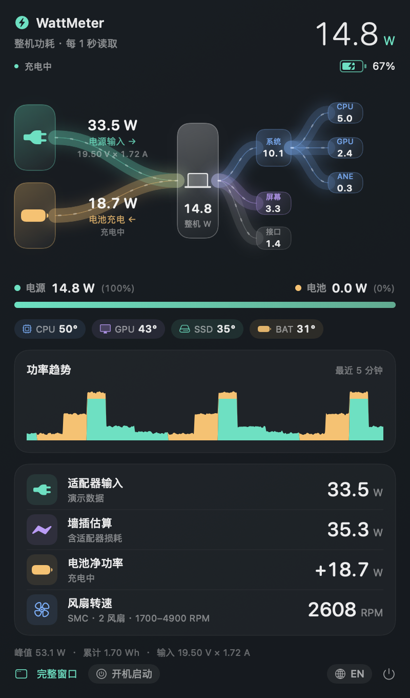
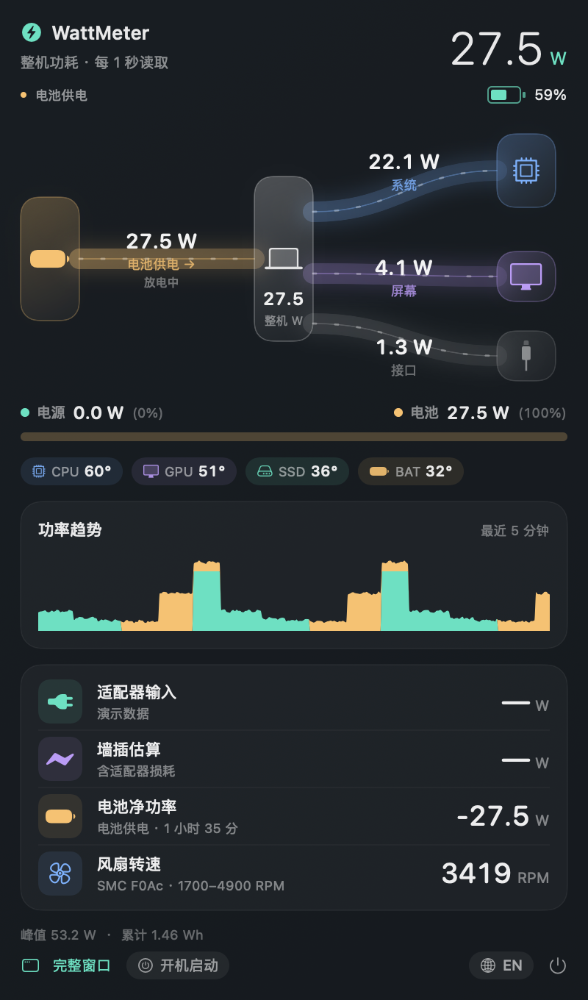
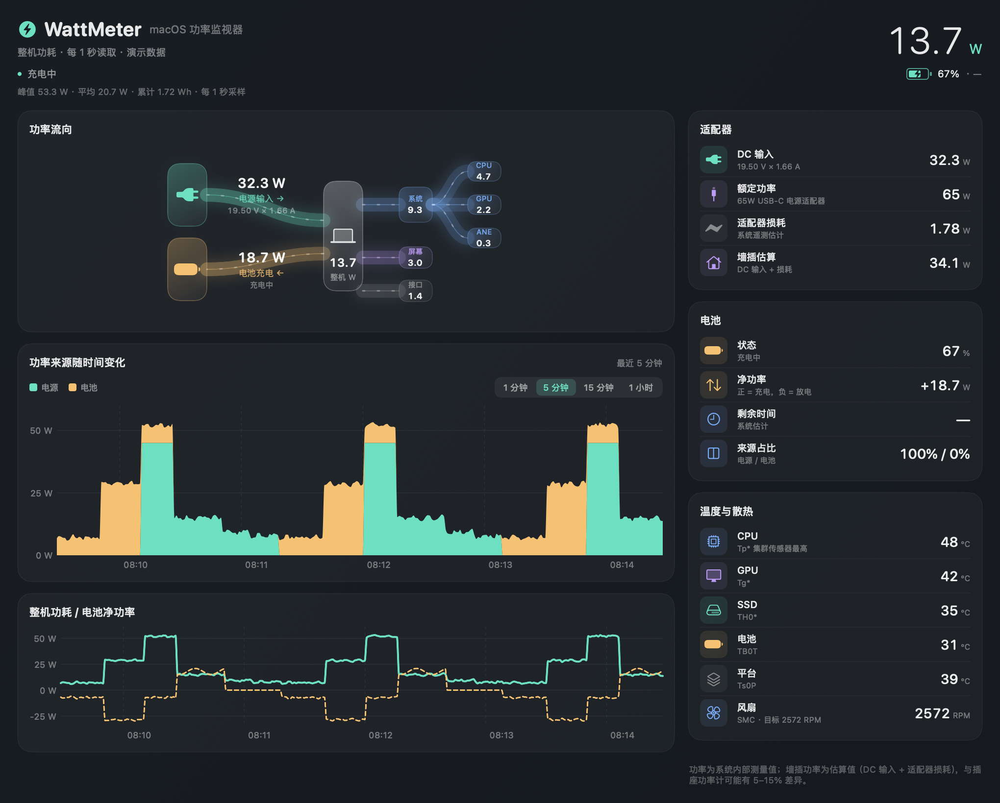
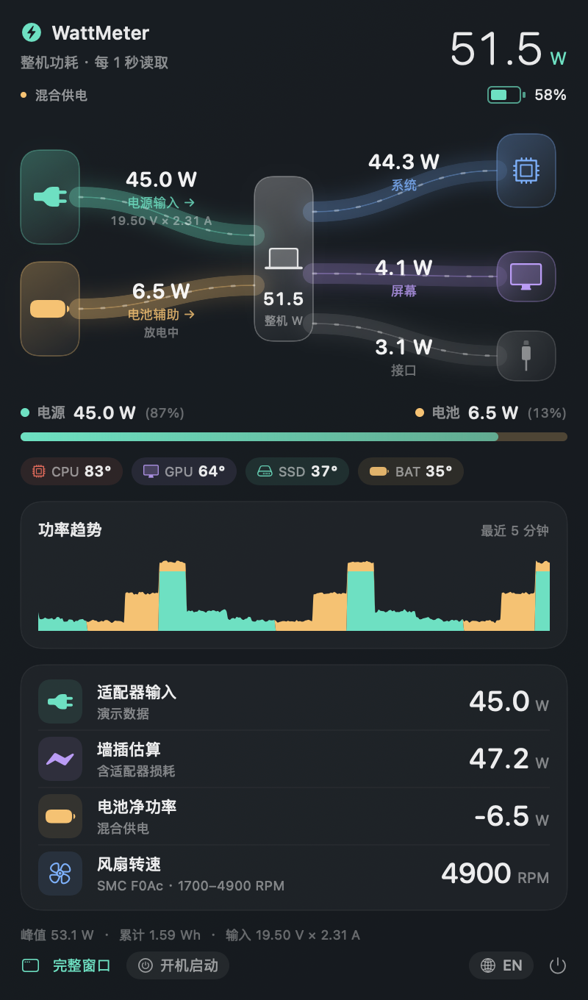

# WattMeter

[English](README.md) · **简体中文**

原生 macOS 菜单栏功率监视器：显示实时整机功率、其中多少来自电源适配器、多少来自电池，以及风扇转速，并以功率流向图和时间序列图表呈现。

- 支持 **Apple Silicon（M 系列）与 Intel Mac**，macOS 13 及以上
- Swift + SwiftUI + Swift Charts，无第三方依赖
- **免 root、免内核扩展、无网络访问** —— 只读 IOKit / SMC
- 可选**开机自动启动**（`SMAppService.mainApp`，不需要辅助进程）
- **中英双语界面**，面板底部或右键菜单切换（会记住选择）
- 只用 macOS 自带的 Command Line Tools 即可构建（不需要 Xcode）

| 菜单栏面板（充电中） | 面板（电池放电） | 主窗口 |
| --- | --- | --- |
|  |  |  |

---

## 1. 显示内容

| 需求 | 实现 |
| --- | --- |
| 整机功率 | 菜单栏实时显示；面板大号读数来自 AppleSMC `PSTR` |
| 功率来自电源还是电池 | Sankey 风格流向图（左：电源/电池，中：整机，右：四条分支）+ 电源/电池占比条 |
| 图形化 | 流向图（左侧电源与电池两个端口常驻、中间整机、右侧负载）；堆叠面积图（电源 vs 电池，1/5/15 分钟）；主窗口的整机功率与电池净功率折线图 |

另外还显示：适配器 DC 输入（含实测输入电压 / 电流）与额定功率、墙插功率估算、电池电量与剩余时间、风扇转速、CPU / GPU / SSD / 电池 / 平台温度、屏幕背光功率、USB-C 对外供电、会话累计电量（Wh）。

---

### 混合供电（弱充电器 + 高负载）

当电源适配器无法单独满足负载时（例如 16 英寸 MacBook 满载却用 45W 充电器），系统会让电池补足差额。
此时流向图左侧会显示**两个供电源**：上方是电源适配器，下方是电池，两条流线汇入整机；状态胶囊显示
「混合供电」，来源条按电源/电池拆分，左侧电池端口显示「放电中」（而不是充电）。



分流是一个纯函数（`PowerReader.split`），由 `wattprobe --split-test` 覆盖验证：

```
电源 → 负载 = min(输入, 负载)
电池 → 负载 = max(0, 负载 - 输入)
充电功率     = max(0, 输入 - 负载)
```

0.7 W 的死区用于避免采样相位差被误显示为电池供电。

## 2. 数据源

| 数据 | API / 键 | 刷新 | 说明 |
| --- | --- | --- | --- |
| 整机功率 | AppleSMC `PSTR` | 亚秒级 | 系统总轨 |
| 适配器 DC 输入 | AppleSMC `PDTR`、`PD0R` | 亚秒级 | `PD0R` 常见于台式机；流向图输入端直接显示实测 V × A |
| 输入电压 / 电流 | AppleSMC `VD0R` / `ID0R` | 亚秒级 | 实测轨；`PDTR` 恒等于 `VD0R × ID0R` |
| 电池功率 | `AppleSmartBattery` 电压 × 电流 | 约 1 秒 | 符号按充放电状态归一化 |
| 电池状态 / 电量 / 剩余时间 | IOKit `IOPowerSources` | 事件驱动 | |
| 适配器额定功率与名称 | `AdapterDetails` | 插拔时 | |
| 兜底遥测 | `PowerTelemetryData` | **约 20 秒** | `SystemLoad` / `SystemPowerIn`、适配器损耗 |
| 风扇 | AppleSMC `F?Ac` / `F?Mn` / `F?Mx` / `F?Tg` | 亚秒级 | 启动时枚举发现，键名与类型随机型不同（`flt` / `fpe2` / `ui16`）；多风扇取最大转速 |
| 屏幕背光 | AppleSMC `PDBR` / `PBwo` / `PBLR` | 亚秒级 | 仅带内置屏的机型 |
| USB-C 对外供电 | AppleSMC `D1..D4 JV×JI`，否则 `PowerOutDetails` | 亚秒级 | 排除充电输入通道 |
| 组件温度 | AppleSMC `Tp*`（CPU）、`Tg*`（GPU）、`TH0*`（SSD）、`TB0*`（电池）、`Ts0P`（平台） | 亚秒级 | 启动时枚举 SMC 键自动发现，因为后缀随机型不同（例如 M2 是 `Tg0e/f/m/n/q/r` 而不是 `Tg0D`）；读不到显示「—」 |

两条实践规则：

1. **实时数值必须来自 SMC。** `PowerTelemetryData` 约 20 秒才刷新一次，只用于兜底（以及适配器损耗估计），不用于实时读数。
2. **电池相关走 IOPS / IORegistry。** SMC 的电池键在不同机型上命名不统一，因此电池功率用电压 × 电流推导，方向由充电状态归一化。

> 参考：`PSTR` 是 AppleSMC 的 “System Total Rail”（[chromium `smc_internal_types_mac.h`](https://chromium.googlesource.com/chromium/src/+/d3c3c840981b951410572e950c8497befdabff05/components/power_metrics/smc_internal_types_mac.h)）；`PDTR` 是适配器 DC 输入，`PowerTelemetryData` 刷新很慢（[mactop fallback 记录](https://github.com/vladkens/macmon/blob/850812f405c2e4180d03a31cf3f77674f9d9520e/docs/plans/20261111-mactop-fallbacks.md)）；IOReport 的 `Energy Model` 在 macOS 27 上不可靠，因此未使用。

---

## 3. 功率模型

设：

- `load` = AppleSMC `PSTR`（整机功率，W）
- `input` = AppleSMC `PDTR` / `PD0R`（适配器 DC 输入，W）
- `loss` = `PowerTelemetryData.AdapterEfficiencyLoss`（W）

负载拆分：

```
电源 → 负载 = min(input, load)
电池 → 负载 = max(0, load - input)      // 弱充电器 + 高负载时电池补足
充电功率     = max(0, input - load)
墙插估算     ≈ input + loss              // 无损耗数据时按 input / 0.9
```

电池净功率（正 = 充电，负 = 放电）：

```
P_battery = Voltage(mV) × Amperage(mA) / 1e6
方向用 IsCharging / ExternalConnected 归一化
系统分项 = 总功率 − 屏幕 − 接口
```

两个工程细节：

1. **采样相位差。** `PSTR` 比 `PDTR` 慢一个 SMC 采样周期，直接相减会凭空出现 ±0.7 W 的「电池功率」。台式机强制 100% 电源，笔记本使用 0.7 W 死区。
2. **优雅兜底。** SMC 键缺失时退回 `PowerTelemetryData`，并在界面上标注数据源。

---

## 4. 架构

```
AppleSMC (PSTR/PDTR/PD0R, F0Ac, PDBR, D1..D4) ─┐
AppleSmartBattery (V/I, AdapterDetails,         ├─> CSystemPower（C，IOKit，免 root）
  PowerTelemetryData)                           │        │
IOPS（状态 / 电量 / 剩余时间）──────────────────┘        ▼
                                              WattMeterCore（Swift）
                                              ├─ PowerReader   原始值 → 功率 + 分流
                                              ├─ PowerSampler  后台 1 Hz 采样
                                              ├─ HistoryBuffer 1 小时环形缓冲 + Wh 积分
                                              └─ PowerStore    @Published 状态（主线程）
                                                        │
                                    WattMeterUI（SwiftUI + Swift Charts）
                                                        │
                     AppKit 菜单栏：NSStatusItem("12.3W") + NSPopover + 主窗口
```

```
wattmeter/
├── Package.swift                 # SwiftPM 清单（有 Xcode 的环境可用）
├── Makefile
├── scripts/
│   ├── build.sh                  # clang + swiftc 构建（无需 Xcode）
│   ├── make-icon.sh              # 生成 Resources/WattMeter.icns
│   └── package-dmg.sh            # 打包可拖拽安装的 DMG
├── Resources/Info.plist          # LSUIElement = true（无 Dock 图标）
├── Sources/
│   ├── CSystemPower/             # SMC 用户客户端 + IORegistry + IOPS
│   ├── WattMeterCore/            # 模型、功率公式、采样器、历史
│   ├── WattMeterUI/              # 深色面板、流向图、图表、主窗口
│   ├── WattMeter/                # AppKit 菜单栏应用
│   ├── wattprobe/                # 命令行探针
│   └── wattmeter-snapshot/       # 离屏渲染截图工具
└── docs/preview-*.png
```

- 采样在后台队列（`DispatchSourceTimer`，1 Hz，120 ms leeway），单次采样远低于 1 毫秒
- 不调用 shell、不使用 `powermetrics`（它需要 root）

---

## 5. 界面设计

视觉语言参考了同为开源菜单栏功率工具的项目 [PowerLens](https://github.com/kinghhhin-design/power)，时间序列图表是本项目新增的。

| 元素 | 说明 |
| --- | --- |
| 面板 | 400 × 680 pt 深色毛玻璃（`NSVisualEffectView`，`.popover` 材质、behind-window、darkAqua） |
| 强调色 | mint `#6EE0C2`（电源）、amber `#F5C273`（电池）、blue `#7DB0FA`（系统）、purple `#BA9CF5`（适配器/接口） |
| 字体 | SF Rounded；主读数 31 pt light，行内读数 19 pt medium，说明文字 9–10 pt |
| 流向图 | 364 × 180：左侧电源端口在上、电池端口在下（**只要装了电池就始终显示**），中间整机，右侧负载（系统 / 屏幕 / 接口）。圆角贝塞尔流线，渐变 + 辉光 + 指示能量方向的光点；充电时光点**从右往左**流入电池，放电/混合供电时从左往右；线宽固定 14 pt，读数跳动时不会抖动 |
| 温度 | 面板内 CPU / GPU / SSD / 电池 温度胶囊；主窗口有完整温度卡。高于 65 °C 转琥珀色，高于 80 °C 转红色 |
| 图表 | 电源与电池的堆叠面积图；主窗口另有整机功率 / 电池净功率折线图 |
| 主窗口 | 1020 × 832 pt（手动缩小时可滚动）：流向图、堆叠面积图、折线图，以及适配器 / 电池 / 温度卡 |
| 语言 | 英文 / 简体中文，面板底部或右键菜单切换（会持久化） |
| 开机启动 | 面板底部或右键菜单里切换。使用 `SMAppService.mainApp`；系统可能要求在「系统设置 → 通用 → 登录项」里批准 |
| 菜单栏 | 等宽数字、按文字宽度自适应、tooltip 带明细、单实例保护 |

充电 / 放电 / 电池待机 / 无电池的台式机各有不同的流向图布局；没有遥测的分支会变淡而不是隐藏。
只要检测到电池，它就**始终**出现在流向图上（充电时在右、供电时在左），纯电池供电模式同样有流动光点。

---

## 6. 构建与运行

环境要求：**macOS 13 及以上**，已安装 Command Line Tools（`xcode-select --install`），不需要 Xcode。
应用打包为通用二进制（arm64 + x86_64），部署目标 macOS 13.0。

### 支持的硬件

| 硬件 | 状态 |
| --- | --- |
| **Apple Silicon Mac（M1 / M2 / M3 / M4 / M5 系列）** | 推荐；SMC 功率轨、风扇、温度、电池与 USB-C 端口均为直读 |
| Intel Mac | 支持；缺少 SMC 键时回退到 `PowerTelemetryData` / IOPS |
| 台式 Mac（Mac mini / Studio / Pro） | 支持；没有电池和内置屏，对应行显示「—」 |
| macOS 13 / 14 / 15 及以上 | 同一个通用二进制即可运行 |

```bash
git clone https://github.com/albertz-source/WattMeter.git
cd WattMeter

./scripts/build.sh                 # 或 ./scripts/build.sh debug
open dist/WattMeter.app            # 菜单栏应用，无 Dock 图标

./scripts/package-dmg.sh           # 打包可拖拽安装的 DMG
./.build/bin/wattprobe             # 命令行探针，每秒一次共 10 次
./.build/bin/wattprobe --keys      # 列出你的机型可用的 SMC 键
./.build/bin/wattmeter-snapshot --view dashboard --state charging --out docs/preview-panel.png
```

自检：

```bash
dist/WattMeter.app/Contents/MacOS/WattMeter --selftest   # 采样 3.5 秒并打印
dist/WattMeter.app/Contents/MacOS/WattMeter --diag       # 检查状态项是否创建成功
dist/WattMeter.app/Contents/MacOS/WattMeter --login-item status   # 查看开机自启状态
dist/WattMeter.app/Contents/MacOS/WattMeter --login-item enable   # 开启（disable 关闭）
```

`scripts/package-dmg.sh` 生成的 DMG 内含 `WattMeter.app`、`Applications` 快捷方式和安装说明：打开后把 App 拖进 Applications 即可。

> 为什么不用 SwiftPM：`swift build` 需要可写的用户级缓存和 manifest 编译的沙盒权限，在受限环境会失败。`scripts/build.sh` 直接调用 `clang`/`swiftc`，所有缓存放在项目内。在装有 Xcode 的普通机器上 `swift build` 同样可用。

### 发布 Release

```bash
# 1. 先改 Resources/Info.plist 里的版本号（CFBundleShortVersionString / CFBundleVersion）
./scripts/build.sh release
./scripts/package-dmg.sh          # 生成 dist/WattMeter-<版本>.dmg
git tag v<版本>
git push origin v<版本>
```

然后在 GitHub 上：**Releases → Draft a new release → 选择该 tag → 附上
`dist/WattMeter-<版本>.dmg` → 发布**。用户下载 DMG 后双击挂载，把 `WattMeter.app`
拖进「应用程序」即可。

### 分发

- 构建产物是 **ad-hoc 签名**；换到别的 Mac 首次打开请右键 → 打开，或执行 `xattr -dr com.apple.quarantine /Applications/WattMeter.app`
- 对外分发需要 Developer ID 签名并公证：
  ```bash
  codesign --deep --force --options runtime --sign "Developer ID Application: ..." dist/WattMeter.app
  xcrun notarytool submit dist/WattMeter-<version>.dmg --keychain-profile "AC_PASSWORD" --wait
  xcrun stapler staple dist/WattMeter-<version>.dmg
  ```
- 不支持 App Sandbox（SMC 用户客户端与 IORegistry 访问在沙盒内不可用），因此不适合上架 Mac App Store

---

## 7. 在自己的机器上验证（含笔记本）

```bash
./.build/bin/wattprobe --keys        # 查看你的机型暴露了哪些功率/风扇/背光 SMC 键
./.build/bin/wattprobe 20 1          # 采样 20 次，每秒一次
./.build/bin/wattprobe --split-test  # 电源/电池/充电分流规则自检
.build/bin/wattprobe --battery     # 电池机型完整诊断
./.build/bin/wattprobe --fans        # 列出所有风扇 SMC 键及其解码值
```

在 MacBook 上，`--battery` 正常应该看到：

- `电池安装: 是`，电池电压 11–13 V，放电时电池电流为**负值**
- `分流` 数值自洽：`电源→负载 + 电池→负载 ≈ 整机`
- 状态判定正确：`纯电池供电` / `充电中` / `混合供电` / `外接电源`

建议手动验证四种场景：

| 场景 | 预期界面 |
| --- | --- |
| 拔掉充电器 | 左侧只有电池一个来源，适配器输入显示「—」（残留的 PDTR 会被忽略） |
| 插电充电 | 左侧电源、右侧充电分支，状态「充电中」 |
| 弱充电器 + 高负载 | 左侧两个来源（电源 + 电池），状态「混合供电」 |
| 接电且已充满 | 只有电源，状态「已充满」 |

代码里已处理的机型差异：`Amperage` 可能以无符号 32 位补码存储、充电口会出现在 `D1..D4` 供电轨里
（按适配器输入功率匹配后排除）、电池温度键随机型不同。

如果机型的 `PSTR` / `PDTR` 缺失，应用会退到 `PowerTelemetryData`（界面标注「系统遥测」）。无风扇机型风扇行显示「—」。

---

## 8. 已知限制

1. **墙插功率是估算值。** `PDTR` 是 AC/DC 转换后的 DC 输入，应用再加上系统报告的适配器损耗；与插座功率计通常有 5–15% 差异。
2. **笔记本电池符号**按充电状态归一化，建议在 MacBook 上与 macOS 自带电池信息做一次对照。
3. Intel Mac 上 `PSTR`/`PDTR` 一般存在；缺失时会退回 IOPS 电压电流 + 遥测。
4. 暂不支持历史持久化、CSV 导出、通知、登录项。
5. 构建产物为 ad-hoc 签名，未公证。
6. 未实现 IOReport 的子系统功率（CPU / GPU / ANE / DRAM）。
7. 温度键随机型不同。应用会在启动时枚举 SMC 自动发现 `Tp*` / `Tg*` / `TH0*`，但部分 Mac 本身就没有 GPU 或电池传感器（台式机没有电池），这些行显示「—」。

---

## 9. 路线图

- [ ] IOReport / PMP 子系统拆分（CPU / GPU / ANE / DRAM），macOS 27 上以 SMC 兜底
- [ ] 在更多 MacBook 机型上验证与校准
- [ ] CSV / JSON 导出、历史落盘、按天统计电费
- [ ] 登录项（`SMAppService`）、阈值通知、低电量提醒
- [ ] Developer ID 签名 + 公证 + DMG 发布流程

---

## 10. 参考资料

- [PowerLens —— 本项目视觉语言参考](https://github.com/kinghhhin-design/power)
- [mactop 的 fallback 记录（PSTR/PDTR/PD0R 语义、macOS 27 上的 Energy Model）](https://github.com/vladkens/macmon/blob/850812f405c2e4180d03a31cf3f77674f9d9520e/docs/plans/20261111-mactop-fallbacks.md)
- [chromium `smc_internal_types_mac.h`（TotalPower = PSTR）](https://chromium.googlesource.com/chromium/src/+/d3c3c840981b951410572e950c8497befdabff05/components/power_metrics/smc_internal_types_mac.h)
- [wattop：PDTR 输入功率与慢速遥测的实践](https://crates.io/crates/wattop)
- Apple IOKit `IOPowerSources.h` / `IOPSKeys.h`、`AppleSmartBattery` IORegistry 节点
