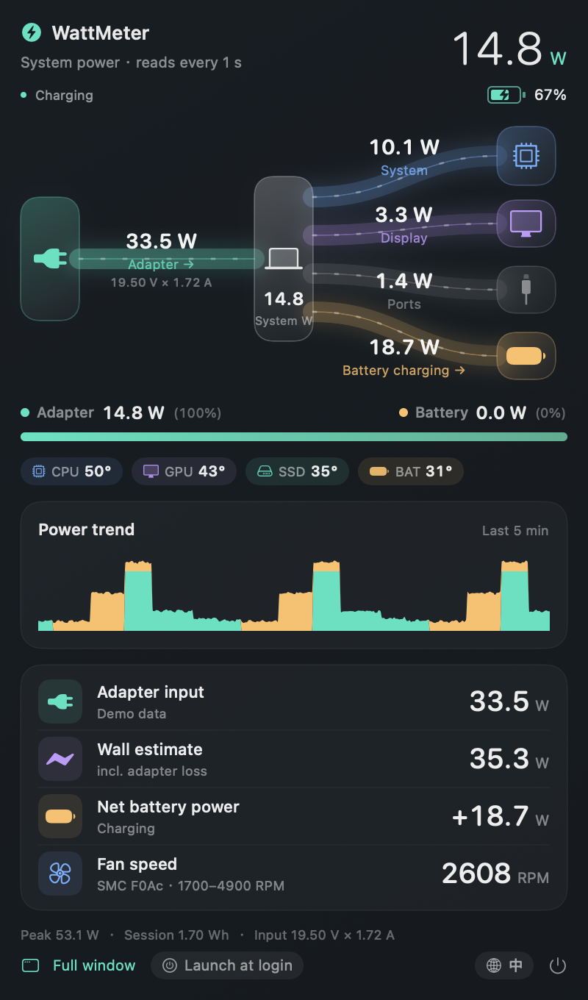

# WattMeter 1.2.1

A native macOS menu-bar power monitor: live system power, adapter vs battery split, component
temperatures, fan speed, and a Sankey-style power-flow diagram.



## Requirements

- **macOS 13 or later** (macOS 13 / 14 / 15 and newer)
- **Apple Silicon (M-series) or Intel Mac** — universal binary (`arm64` + `x86_64`)
- No root, no kernel extension, no network access; the app only reads IOKit / SMC

## What's new in 1.2.1

### Fixed: the app now runs on macOS 13–15 (and on Intel)

The 1.2.0 build recorded the build machine's macOS version (27.2) as its minimum requirement, so
older systems refused to launch it with *"this version of the application cannot be used with this
version of macOS"*. The app is now compiled with a **macOS 13.0 deployment target** and shipped as a
**universal binary**:

```
$ lipo -info WattMeter.app/Contents/MacOS/WattMeter
Architectures in the fat file: ... are: x86_64 arm64

$ vtool -show-build WattMeter.app/Contents/MacOS/WattMeter
  platform MACOS   minos 13.0   (arm64)
  platform MACOS   minos 13.0   (x86_64)
```

### Flow diagram: the battery is always visible

The left column is now a permanent pair of energy ports — adapter on top, **battery below** — and the
battery no longer disappears when the charger is connected:

| State | Diagram |
| --- | --- |
| Charging | adapter and battery ports on the left; dots flow **right-to-left** into the battery |
| Fully charged / idle on AC | both ports stay visible; battery shows “idle” with no animation |
| Hybrid (weak charger + high load) | both ports on the left, battery supplements the adapter |
| Battery only | battery is the single source, flow animated as usual |
| Desktop Mac (no battery) | adapter only |

The right column now contains loads only (system / display / ports).

### MacBook battery fixes

- Battery current is decoded as **signed** even when a model stores `Amperage` as an unsigned 32-bit
  two's-complement value (battery power could previously be unreadable).
- Unplugging no longer leaves a stale `PDTR` that made the UI flash “hybrid” while on battery.
- In hybrid mode the net battery power is forced negative (discharging).
- The charging port is excluded from the `D1..D4` USB-C output rails, so “Ports” no longer
  double-counts the charger.

### Diagnostics

```bash
# full battery-machine dump (voltage/current, adapter, SMC rails, split, ports, temps, state)
./.build/bin/wattprobe --battery

# self-check of the adapter / battery / charge split (9 cases)
./.build/bin/wattprobe --split-test
```

## Install

1. Download **WattMeter-1.2.1.dmg** below and open it.
2. Drag **WattMeter.app** into the **Applications** folder, then eject the disk image.
3. First launch: right-click the app → **Open** (the build is ad-hoc signed, not notarised), or run:

   ```bash
   xattr -dr com.apple.quarantine /Applications/WattMeter.app
   ```

4. The menu bar shows live power (e.g. `12.3W`). Click it for the panel; right-click for the main
   window, launch-at-login, language and quit.

## Verification

```
SHA-256  WattMeter-1.2.1.dmg
9340f50f8ad996d3d67c488e6d47142f88a7b0d5b4acbd9ab41854358abc3813
```

---

## 简体中文

### 主要修复

1. **支持 macOS 13 及以上**：1.2.0 的二进制把构建机系统版本（27.2）写成了最低要求，导致
   macOS 15 提示「不能与此版本的 macOS 配合使用」。现在部署目标为 macOS 13.0，并且是
   **通用二进制**（arm64 + x86_64），Apple Silicon 与 Intel 都能运行。
2. **电池在流向图上始终显示**：左列固定为「电源端口在上、电池端口在下」。充电时光点从右往左
   流入电池；放电/混合供电时从左往右；纯电池供电同样有流动动画；台式机无电池时只显示电源。
3. **MacBook 电池适配**：修正无符号补码电流、拔电后 PDTR 残留、混合供电符号、充电口被重复计入
   USB-C 对外供电等问题。
4. 新增 `wattprobe --battery`（电池机型完整诊断）和 `wattprobe --split-test`（分流规则自检）。

### 安装

下载 DMG → 打开 → 把 `WattMeter.app` 拖进「应用程序」→ 首次打开若被拦截，右键 → 打开，
或执行 `xattr -dr com.apple.quarantine /Applications/WattMeter.app`。

### 系统要求

macOS 13 及以上（macOS 13 / 14 / 15 均可），支持 **Apple Silicon（M1 / M2 / M3 / M4 / M5 系列）**
与 Intel Mac。
