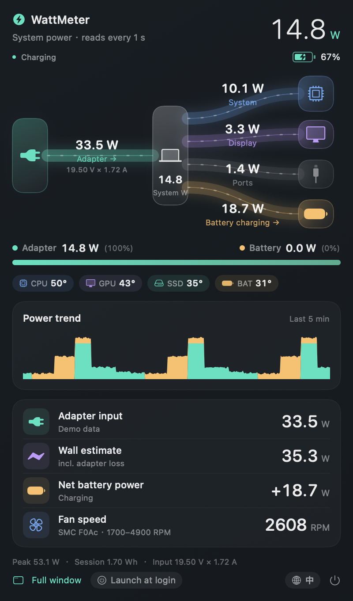

# WattMeter 1.2.2

A native macOS menu-bar power monitor: live system power, adapter vs battery split, component
temperatures, fan speed, and a Sankey-style power-flow diagram.



## Requirements

- **macOS 13 or later** (macOS 13 / 14 / 15 and newer)
- **Apple Silicon (M-series) or Intel Mac** — universal binary (`arm64` + `x86_64`)
- No root, no kernel extension, no network access; the app only reads IOKit / SMC

## What's new

### Runs on macOS 13–15 and on Intel

The earlier build recorded the build machine's macOS version (27.2) as its minimum requirement, so
older systems refused to launch it. The app now uses a **macOS 13.0 deployment target** and ships as
a **universal binary** (`x86_64` + `arm64`).

### Fan speed on more Macs (including M4)

Fan SMC keys are now **discovered at launch** instead of assuming `F0Ac`. Names and payload types
differ between models (`flt`, `fpe2`, `ui16`, `si16`, `ui8`), and 14"/16" MacBook Pros expose more
than one fan — the app reports the maximum RPM and the number of fans.

```bash
./.build/bin/wattprobe --fans   # list every fan SMC key with its decoded value
```

### Flow diagram: the battery is always visible

The left column is now a permanent pair of energy ports — adapter on top, **battery below**. The
battery no longer disappears when the charger is connected.

| State | Diagram |
| --- | --- |
| Charging | both ports on the left; dots flow **right-to-left** into the battery |
| Fully charged / idle on AC | both ports stay visible; battery shows “idle” |
| Hybrid (weak charger + high load) | battery supplements the adapter, left-to-right |
| Battery only | battery is the single source, flow animated as usual |
| Desktop Mac (no battery) | adapter only |

The right column contains loads only (system / display / ports).

### MacBook battery fixes

- Battery current is decoded as **signed** even when a model stores `Amperage` as an unsigned 32-bit
  two's-complement value.
- Unplugging no longer leaves a stale `PDTR` that made the UI flash “hybrid” while on battery.
- Hybrid mode always shows the battery as discharging.
- The charging port is excluded from the `D1..D4` USB-C output rails.

### Diagnostics

```bash
./.build/bin/wattprobe --battery      # battery, adapter, split, ports, temps, state
./.build/bin/wattprobe --fans         # fan SMC keys and decoded values
./.build/bin/wattprobe --split-test   # 9 split-rule assertions
```

## Install

1. Download **WattMeter-1.2.2.dmg** below and open it.
2. Drag **WattMeter.app** into **Applications**, then eject.
3. First launch: right-click → **Open** (ad-hoc signed), or:

   ```bash
   xattr -dr com.apple.quarantine /Applications/WattMeter.app
   ```

## 简体中文

1. **支持 macOS 13 及以上**，通用二进制（Apple Silicon + Intel）。
2. **更多机型能读到风扇转速**：风扇 SMC 键改为启动时自动枚举（支持 `flt` / `fpe2` / `ui16` /
   `si16` / `ui8`），14/16 寸 MacBook Pro 多风扇取最大转速并显示风扇数量。
3. **电池在流向图上始终显示**：左列固定为电源端口（上）+ 电池端口（下）；充电时光点自右向左流
   入电池，放电/混合供电时自左向右；纯电池供电同样有动画。
4. **MacBook 电池适配**：有符号电流解码、拔电残留、混合供电符号、充电口不计入 USB-C 对外供电。
5. 新增诊断：`wattprobe --battery`、`wattprobe --fans`、`wattprobe --split-test`。

安装：下载 DMG → 拖进「应用程序」→ 首次打开右键「打开」，或
`xattr -dr com.apple.quarantine /Applications/WattMeter.app`。
