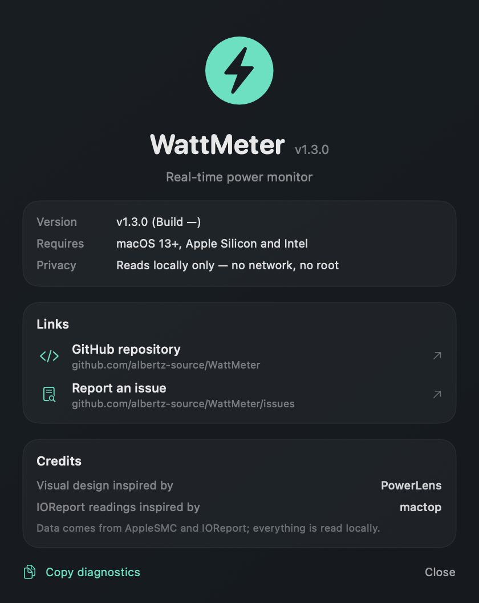

# WattMeter 1.3.1

A native macOS menu-bar power monitor: live system power, adapter vs battery split, CPU / GPU /
ANE / DRAM power, temperatures, fan speed, and a Sankey-style power-flow diagram.

## What's new

### About window

Open it from the ⓘ button in the panel title bar, the main window header, or the right-click menu.
It shows:

- app icon, version and build number
- system requirements (macOS 13+, Apple Silicon and Intel)
- privacy note (local-only, no root, no network)
- links to the GitHub repository and issue tracker
- credits (PowerLens for the visual language, mactop for the IOReport approach)
- a **Copy diagnostics** button that puts the battery/fan diagnostic output on the clipboard, handy
  when reporting an issue

### Flow diagram: single hub on each side

All links now converge into one point on each edge of the machine node (left and right midpoints)
instead of attaching at several heights, so the diagram reads as one hub fanning out to the left
sources and right loads.

### Also included from 1.3.0

- CPU / GPU / ANE / DRAM power in the flow diagram (IOReport `Energy Model` merged with `GPU Stats` /
  `CPU Stats` / `AMC Stats`; PMP histogram fallback when macOS 27 gates the CPU counters; SMC `PZD*`
  fallback for DRAM)
- chip branches without a usable reading are hidden; when all of CPU/GPU/ANE are unavailable the
  diagram falls back to the plain system / display / ports layout
- macOS 13+ universal build, always-visible battery port, fan-key discovery, battery-machine fixes

## Install

1. Download **WattMeter-1.3.1.dmg** and open it.
2. Drag **WattMeter.app** into Applications, eject.
3. First launch: right-click → Open (ad-hoc signed), or
   `xattr -dr com.apple.quarantine /Applications/WattMeter.app`

## 简体中文

- 新增「关于」窗口：标题栏 ⓘ、主窗口 ⓘ 或右键菜单打开；显示版本/构建、系统要求、隐私说明、
  项目链接与致谢，并提供「复制诊断信息」按钮（直接粘贴给开发者排查）。
- 同时包含 1.3.0 的全部内容：CPU / GPU / ANE / DRAM 分项功率（IOReport + PMP 兜底）、
  无数据分项自动隐藏、macOS 13+ 通用二进制、电池常驻、风扇键自动发现等。
