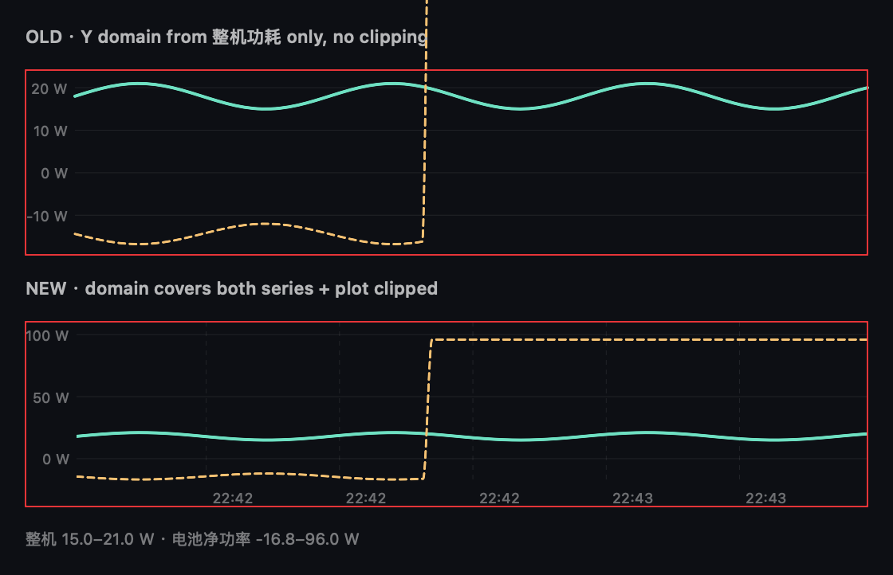

# WattMeter 1.3.2

A native macOS menu-bar power monitor: live system power, adapter vs battery split, CPU / GPU /
ANE / DRAM power, temperatures, fan speed, and a Sankey-style power-flow diagram.

## Fixed

### 整机功耗 / 电池净功率 line chart no longer draws outside its frame

The Y-axis domain of the **System power / Battery net power** line chart was derived from system
power only. A battery charging at a higher wattage than the system was drawing (for example 96 W of
charge power on a 20 W system load) was therefore plotted above the top of the plot area and spilled
out of the chart frame.

The domain now spans **both** series (including negative battery values), so the chart always scales
to fit the battery line as well, and the plot area is clipped to its bounds as a safety net.

The image above renders one dataset (system 15–21 W, battery net power −16.8 W … +96 W) through both
versions: the old chart jumps out of the red frame, the new one stays inside.

## Also included since 1.2.2

- **About window** (ⓘ in the panel / main window / right-click menu): version and build, system
  requirements, privacy note, project links, credits, and a **Copy diagnostics** button.
- **Flow diagram**: CPU / GPU / ANE / DRAM branches, hidden when a reading is unavailable; all links
  converge into a single hub on each side of the machine node; the adapter shows input voltage and
  current; the battery port is always visible.
- **Chip power** from IOReport (`Energy Model` merged with `GPU Stats` / `CPU Stats` / `AMC Stats`),
  with a PMP histogram fallback for the macOS 27 CPU gate and an SMC `PZD*` fallback for DRAM.
- Fan speed on M3 / M4 Macs, including a “stopped” state at 0 rpm.
- Launch at login, English-primary UI with Chinese available.

## Requirements

- **macOS 13 or later** (macOS 13 / 14 / 15 and newer)
- **Apple Silicon (M-series) or Intel Mac** — universal binary (`arm64` + `x86_64`)
- No root, no kernel extension, no network access; the app only reads IOKit / SMC

## Install

1. Download **WattMeter-1.3.2.dmg** and open it.
2. Drag **WattMeter.app** into Applications, eject.
3. First launch: right-click → Open (ad-hoc signed), or
   `xattr -dr com.apple.quarantine /Applications/WattMeter.app`

## 简体中文

### 修复：整机功耗 / 电池净功率折线画出框外

折线图的 Y 轴范围之前只按「整机功耗」计算，所以当电池净功率（充电时为正）高于整机功耗时，
例如整机 20 W、电池充电 96 W，电池那条线会超出绘图区、画到图表框外面。

现在 Y 轴范围同时覆盖两条曲线（含电池的负值），并且绘图区做了裁剪兜底，任何情况下都不会
画出框外。上图用同一组数据（整机 15–21 W，电池 −16.8 W … +96 W）对比了旧版和新版：旧版
虚线冲出红框，新版完整留在框内。

### 同时包含 1.2.2 以来的全部更新

- **关于窗口**：标题栏 ⓘ / 主窗口 ⓘ / 右键菜单打开，显示版本与构建、系统要求、隐私说明、
  项目链接、致谢，并提供「复制诊断信息」按钮。
- **流向图**：CPU / GPU / ANE / DRAM 分项（无数据自动隐藏）；左右两侧所有连线收敛到单一枢纽点；
  适配器节点显示输入电压与电流；电池端口常驻。
- **分项功率**：IOReport（`Energy Model` + `GPU Stats` / `CPU Stats` / `AMC Stats`），
  macOS 27 的 CPU 门控有 PMP 直方图兜底，DRAM 可回退 SMC `PZD*`。
- M3 / M4 机型的风扇转速（含 0 rpm「已停转」状态）。
- 登录时启动；界面以英文为主，可切换中文。
